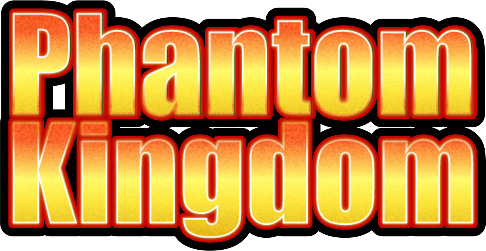

# PhantomKingdom

**Play Pocket Kingdom: Own the World on your Android phone, online again.**

Pocket Kingdom: Own the World (SEGA / Sonic Team, 2004) was one of the
N-Gage's online games: you build up a kingdom, form parties of units and
fight other players' kingdoms. Its online service, **N-Gage Arena**, was
shut down in 2010, and the game has been limited to the N-Gage ever since.

PhantomKingdom brings the game to your Android phone. It is a
reimplementation of the original program that runs with the data files of
your own game card, so no game data is included or downloaded.

It goes online through [PhantomLink](https://github.com/ngagesdk/PhantomLink),
the replacement for N-Gage Arena, and plays together with other PhantomKingdom
players and with original N-Gages connected to the same server.

**Online Mode:** To unlock online play, defeat the Boss Kingdom on the third
map to obtain the Online Crest. Once you have it, you can connect to N-Gage
Arena and battle other kingdoms online.

## How it works

The app imports the original data files (graphics, sound, text and tables)
from your copy of the game and plays the game as on the N-Gage: same
timing, same screens, same rules. The picture is shown at the largest
whole-number scale that fits the screen, so the pixel art stays sharp.

For online play the app connects to a PhantomLink server the way the
original game connected to N-Gage Arena. PhantomLink binds Arena accounts
to an N-Gage's IMEI, so each installation gets a random N-Gage ID that
stays the same until the app is uninstalled.

## Features

- The complete offline game: kingdom, parties, shop, lab, map, quests,
  battles with all 49 unit classes, the ending and the staff roll.
- N-Gage Arena through PhantomLink: rival kingdoms, scouting and attacks
  against other players, letters and the Global Auction.
- Touch controls made for phones, with a short vibration for every touch
  the game takes. Gamepads and keyboards work too.
- Imports your game data from a ZIP archive or a folder, without any
  storage permission.
- Save games in the original format, included in Android backups.

## Quickstart

1. **Install the app.** Android 7.0 or newer is required.

   

2. **Copy your game data.** Copy the `\System\Apps\6RAH\` folder of your
   Pocket Kingdom game card, or the whole card, to your phone, as a folder
   or a ZIP archive.
3. **Import it.** Open the app and tap **ZIP archive** or **Folder** on the
   **Game** tab, then select the data.
4. **Set up online play.** On the **Settings** tab, enter your N-Gage Arena
   user name and password for the PhantomLink server. A server is
   prefilled; enter another address to use your own.
5. **Play.** Tap the play button. Choose **N-Gage Arena** in the game's
   title menu to play online.

For building the app and other ways to copy the game data, see
[android/README.md](android/README.md). APKs of every build are available
on the [Continuous Integration](https://github.com/ngagesdk/PhantomKingdom/actions/workflows/continuous-integration.yml)
page.

For online play and running your own server, see
[docs/NETWORK.md](docs/NETWORK.md).

## Documentation

- [android/README.md](android/README.md) - Android app
- [docs/USAGE.md](docs/USAGE.md) - game data, controls and options
- [docs/BUILD.md](docs/BUILD.md) - building from source
- [docs/STATUS.md](docs/STATUS.md) - implementation status
- [docs/NETWORK.md](docs/NETWORK.md) - online play with PhantomLink
- [docs/FORMATS.md](docs/FORMATS.md) - file formats of the original game
- [docs/RE_NOTES.md](docs/RE_NOTES.md) - notes on the original program
- [docs/LEGAL.md](docs/LEGAL.md) - legal notes
- [docs/THIRD_PARTY.md](docs/THIRD_PARTY.md) - third-party components

## License

Copyright 2026 Michael Fitzmayer. Released under the MIT license, see
[LICENSE](LICENSE).

The repository must never contain game files or anything extracted from
them, see [docs/LEGAL.md](docs/LEGAL.md). Not affiliated with SEGA or Nokia.

Both [PhantomKingdom logos](media/) were provided by [Dan Whelan](https://danwhelan.ie/)
and are released under the
[CC0 1.0 Universal license](https://creativecommons.org/publicdomain/zero/1.0/).

